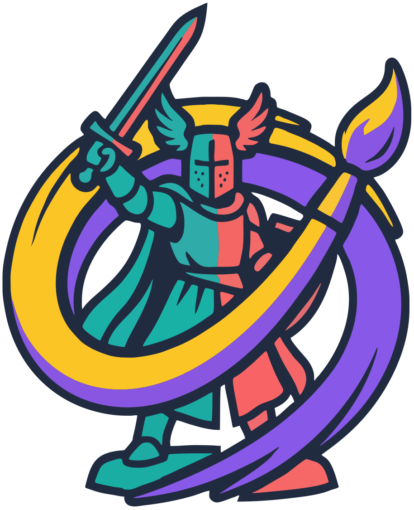

<p align="center">
  
</p>

# Model Painter — Miniature Painting Companion (`model-painter`)

A product-agnostic **Angular** + **Firebase** miniature painting companion for tracking projects, miniature recipes, color guides, and paint inventories across all major miniature paint brands (**Citadel Colour**, **Citadel Tone Pro**, **The Army Painter**, **Vallejo**, **Two Thin Coats**, **Monument Hobbies Pro Acryl**, **AK Interactive 3rd Gen**, and custom paints), complete with local-first browser storage, **"Can I Paint This?"** inventory readiness calculation, and optional **My Warhammer** account import.

---

## ✨ Key Features

1. **Hobby Desk (Local-First in Browser `localStorage` + Optional Firebase Cloud Sync)**
   - **My Projects:** Create, rename, duplicate, and delete projects; attach **Model Painting Guides** (`recipes`), **Color Guides** (`colors`), and drag-and-drop block **Notes & Checklists** (`@angular/cdk/drag-drop`).
   - **Aggregated Required & Missing Paints Rollup Tab:** Automatically deduplicates every paint required across a project's attached models and colors, grouping them into **Missing**, **Covered by Equivalent** (Tone Pro or 3rd-Party), and **Owned Directly**, with 1-click **"★ Add All Missing Paints to Wishlist"**.
   - **My Paints (`Inventory`, `Wishlist`, & `Full Catalogue`):** Track all **487 Citadel Paints** (`warhammer_colour` Classic & `warhammer_pro` Tone Pro) and **145+ pre-seeded 3rd-party paints**, plus add your own **Custom 3rd-Party Paints** and equivalence overrides.
   - **Multi-Brand Comparison & Conversion Tool:**
     - **Mode 1:** Cross-Brand Converter (**Citadel** ↔ **The Army Painter** *Warpaints Fanatic / Original / Speedpaint 2.0*, **Vallejo** *Game Color / Model Color*, **Two Thin Coats**, **Monument Hobbies** *Pro Acryl*, **AK Interactive** *3rd Gen*) with CIE76 $\Delta E$ color distance metrics.
     - **Mode 2:** Official **Citadel Classic ↔ Tone Pro** compatibility (`128` classic paints mapped to `379` Tone Pro equivalents + **Tone Pro 1–5 Pentad Strips**).
2. **Multi-User "My Warhammer" Account Importer**
   - **1-Click Extracted Account Snapshot:** Load the extracted `user_account_snapshot.json` (`64` inventory paints, `34` wishlist paints, `5` custom projects).
   - **Self-Service Auth0 PKCE Login Wizard:** Generate an OAuth2 PKCE login link for `login.mywarhammer.com`, paste the `citadel-colour://.../callback?code=...` redirect URL, and exchange it via the stateless `importMyWarhammerAccount` Cloud Function (`functions/src/index.ts`).
   - **JSON / CSV Upload & Full Backup Portability:** Import/export `user_account.json`, `user_inventory_wishlist.csv`, or full Web App JSON backups.
3. **Paint A Model (`4,531` Miniature Painting Guides)**
   - Browse by **15 Game Systems** and **335 hierarchical Faction nodes**.
   - **"Can I Paint This?"** Inventory Readiness filter (`100% Paint Ready`, `Missing ≤ 2 Paints`, `Sort by Match %`).
   - Interactive normalized `(x, y)` **Color Point Pins** on miniature photos, progressive **Painting Areas** (`Base Finish`, `Detail Finish`, `Artificer Finish`), and inline **Owned Substitute Badges** (`⇄ Covered by ...`).
4. **Paint A Color (`596` Color & Basing Guides)**
   - Filter by **16 Color Groups** or toggle **"Only show guides for painting bases"** (`17` basing guides).
   - Interactive **Space Marine Backpack Showcase Image** switcher (`Base` / `Detail` / `Artificer`) and reverse lookup of **Models Using This Color**.
5. **Smart `IndexedDB` + Manifest Hash-Diffing Cache (`catalog_meta/manifest`)**
   - Hydrates in `0ms` from browser `IndexedDB` (`whc_catalog_cache_v1`), performs a `1`-document manifest check on startup (`catalog_meta/manifest`), diffs SHA-256 hashes per bundle, and re-fetches **only** changed bundles.

---

## 🚀 Quick Start (Local Development)

```bash
pnpm install
pnpm run start
```

Then open `http://localhost:4204` in your browser.

---

## 🧪 Testing, Linting & Type-Checking

```bash
pnpm run lint                                            # Offline AST/HTML/unused-symbol lint checks
pnpm run typecheck                                       # tsc --noEmit (app, unit specs, browser specs, functions)
pnpm --dir functions run build                           # Compile Cloud Functions TypeScript
pnpm run test:rules                                      # Firestore/Storage rules parity & emulator tests
pnpm run test:scripts                                    # All Node script, lint, SPA server & catalog schema tests
pnpm exec ng test --watch=false --browsers=ChromeHeadless # Angular Karma/Jasmine unit suite
pnpm run test:screenshot                                 # Vitest browser visual regression suite
```

---

## ☁️ Deploying to Firebase (Hosting, Firestore, Cloud Storage & Functions)

1. **Seed Cloud Firestore & Firebase Cloud Storage** (optional — the app also includes static bundle fallback in `public/data/catalog_meta/`):
   ```bash
   export GOOGLE_APPLICATION_CREDENTIALS="/path/to/serviceAccountKey.json"
   export FIREBASE_STORAGE_BUCKET="your-project-id.firebasestorage.app"
   python3 scripts/seed_firebase.py
   ```
2. **Build & Deploy:**
   ```bash
   pnpm run build
   firebase deploy
   ```

---

## 📂 Repository Structure

- `src/app/` — Angular 19 Standalone Components, Signals services (`CatalogService`, `UserStateService`, `InventoryMatchService`, `WarhammerImportService`), and routing.
- `public/fonts/` & `public/icons/` — Subsetted `.woff2` `Anton` (`anton_regular.woff2`) & `Bitter` (`bitter_regular.woff2`) fonts and `46` SVG vector icons extracted from the APK.
- `public/data/catalog_meta/` — Read-optimized catalog bundles (`paints_bundle.json`, `third_party_paints_bundle.json`, `colours_bundle.json`, `games_factions_bundle.json`, `models_index_0..5.json`, and `manifest.json` with SHA-256 hashes & `staticOnly` metadata).
- `functions/` — Stateless Firebase Cloud Function (`importMyWarhammerAccount`) for multi-user Auth0 PKCE token exchange.
- `scripts/` — Data bundling (`build_third_party_paints.py`, `prepare_local_bundles.py`), APK asset extraction (`extract_apk_assets.py`), Firebase seeding & sync (`seed_firebase.py`, `sync_recipes_and_colours.py`), static SPA server (`serve_spa.mjs`), offline linter (`lint.mjs`), and Node test suites (`rules_parity.test.mjs`, `firestore_rules.test.mjs`, `serve_spa.test.mjs`, `lint.test.mjs`, `catalog_schema.test.mjs`).
- `extractor/` — Phase 1–4 Python scripts used to extract the GraphQL catalog, user account data, CSV/JSON datasets, and `6,430` high-res media assets from the Android APK.
- `docs/` — Architectural specifications (`warhammer_colour_web_app_plan.md` & `warhammer_colour_extraction_plan.md`).
- `IDEAS.md` — Future feature ideas and roadmap (community model builds/kitbashes, sponsored/affiliate links, community catalog & reference photo proposals, and saving public photos to personal model/project reference galleries).
