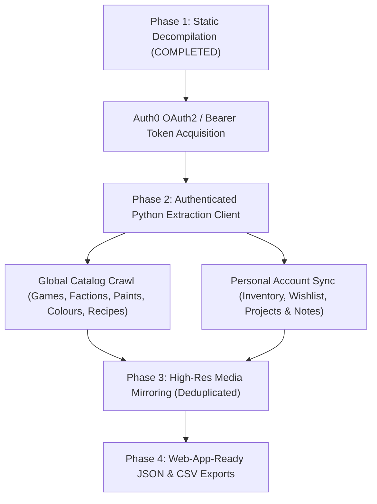

# Warhammer Colour (`com.gamesworkshop.citadelpaint`) Data Extraction Plan

This document details the architecture, **completed Phase 1 static analysis findings**, and the execution plan for extracting both the **Global Catalog Data** (paints, miniatures, progressive painting recipes, colour groups, compatibility mappings) and **Personal Account Data** (inventory, wishlist, custom projects) from the official **Paint Warhammer / Citadel Colour** Android application (`com.gamesworkshop.citadelpaint` v3.1.1).

> [!IMPORTANT]
> **Phase 1 Complete — No MITM Proxy / Frida Required:** Static decompilation of `base.apk` (`jadx`) completely exposed the Ktor REST client (`https://api.apps.paint.warhammer.com`), all `@Serializable` request/response DTOs, and the Auth0 OAuth2 PKCE configuration (`login.mywarhammer.com`). Dynamic traffic interception with an emulator or Frida is unnecessary.

---

## Architecture & Extraction Workflow



---

## Phase 1 Findings: Static APK Analysis (Completed)

### 1.1 Application Tech Stack
- **Package Name:** `com.gamesworkshop.citadelpaint` (`versionCode=50141`, `versionName=3.1.1`)
- **Architecture:** Native Kotlin Android app built with Jetpack Compose, Ktor HTTP Client, `kotlinx.serialization`, AndroidX DataStore, and Room ([`AppDatabase`](file:///home/antigravity/apk_analysis/jadx_out/sources/com/gamesworkshop/citadelpaint/data/local/AppDatabase.java) used only by [`LegacyDatabaseMigrationWorker`](file:///home/antigravity/apk_analysis/jadx_out/sources/com/gamesworkshop/citadelpaint/workers/LegacyDatabaseMigrationWorker.java) to migrate v1/v2 local data to the v3 cloud API).
- **No Bundled Catalog DB:** All catalog and user data is served dynamically from `https://api.apps.paint.warhammer.com`.

### 1.2 My Warhammer / Auth0 Configuration
Defined in [`strings.xml`](file:///home/antigravity/apk_analysis/jadx_out/resources/res/values/strings.xml#L62-L278) and [`AndroidManifest.xml`](file:///home/antigravity/apk_analysis/jadx_out/resources/AndroidManifest.xml#L95-L108) and managed by [`ek.java`](file:///home/antigravity/apk_analysis/jadx_out/sources/defpackage/ek.java) / [`vn4.java`](file:///home/antigravity/apk_analysis/jadx_out/sources/defpackage/vn4.java):

| Parameter | Value | Source |
| :--- | :--- | :--- |
| **Auth0 Domain** | `login.mywarhammer.com` | `@string/com_auth0_domain` |
| **Client ID** | `GfkrpDHeRsWqbwJM1tB6deAjJnd8U8jp` | `@string/com_auth0_client_id` |
| **Audience** | `https://warhammer-paint.com/app` | `@string/stc_account_application_auth_audience` |
| **Scope** | `openid profile offline_access` | `@string/stc_account_application_auth_scope` |
| **Redirect URI** | `citadel-colour://login.mywarhammer.com/android/com.gamesworkshop.citadelpaint/callback` | `AndroidManifest.xml` (`RedirectActivity`) |
| **Auth Header** | `Authorization: Bearer <access_token>` | [`a22.java`](file:///home/antigravity/apk_analysis/jadx_out/sources/defpackage/a22.java#L41-L65) |

> [!NOTE]
> Almost every method in [`id0.java`](file:///home/antigravity/apk_analysis/jadx_out/sources/defpackage/id0.java) (including catalog endpoints like `/games`, `/colours`, `/paints`, and `/recipes/{id}`) retrieves the Auth0 access token via `ek.b()` and attaches `Authorization: Bearer <token>`.

### 1.3 Complete REST API Catalog (`https://api.apps.paint.warhammer.com`)
All endpoints accept `?locale=en` (appended by [`a22.i()`](file:///home/antigravity/apk_analysis/jadx_out/sources/defpackage/a22.java#L228-L237)).

#### Global Catalog Endpoints
| Domain | Method & Path | Request Body / Query | Response DTO | Decompiled Method |
| :--- | :--- | :--- | :--- | :--- |
| **Games & Miniatures** | `GET /games?locale=en` | — | `List<GameDto>` ([`ft1`](file:///home/antigravity/apk_analysis/jadx_out/sources/defpackage/ft1.java): `id`, `name`, `imageUrl`, `recipes`) | [`id0.fetchAllGames`](file:///home/antigravity/apk_analysis/jadx_out/sources/defpackage/id0.java#L2295-L2366), [`id0.q`](file:///home/antigravity/apk_analysis/jadx_out/sources/defpackage/id0.java#L4026-L4120), [`id0.r`](file:///home/antigravity/apk_analysis/jadx_out/sources/defpackage/id0.java#L4136-L4230) |
| **Recipes by Game** | `POST /games/{gameId}/recipes?locale=en` | `FiltersDto` ([`ki1`](file:///home/antigravity/apk_analysis/jadx_out/sources/defpackage/ki1.java)) | `List<RecipeDto>` ([`eb4`](file:///home/antigravity/apk_analysis/jadx_out/sources/defpackage/eb4.java)) | [`id0.fetchMiniaturesByGame`](file:///home/antigravity/apk_analysis/jadx_out/sources/defpackage/id0.java#L2612-L2700), [`id0.u`](file:///home/antigravity/apk_analysis/jadx_out/sources/defpackage/id0.java#L4545-L4645) |
| **Miniatures Search** | `GET /miniatures` | Query params (`sortBy`, `sortDirection`, `query`, `gameSystems`, `factions`, `guideType`) | `List<RecipeDto>` ([`db4`](file:///home/antigravity/apk_analysis/jadx_out/sources/defpackage/ed0.java#L974)) | [`id0.H`](file:///home/antigravity/apk_analysis/jadx_out/sources/defpackage/id0.java#L1185-L1371) |
| **Full Recipe Details** | `GET /recipes/{recipeId}?locale=en` | — | `RecipeDto` ([`eb4`](file:///home/antigravity/apk_analysis/jadx_out/sources/defpackage/eb4.java) / [`fb4`](file:///home/antigravity/apk_analysis/jadx_out/sources/defpackage/ed0.java#L1192)) | [`id0.fetchRecipe`](file:///home/antigravity/apk_analysis/jadx_out/sources/defpackage/id0.java#L2800-L2885), [`id0.y`](file:///home/antigravity/apk_analysis/jadx_out/sources/defpackage/id0.java#L4860-L4948) |
| **AllPaints / Search** | `POST /paints?locale=en` | `FiltersDto` ([`ki1`](file:///home/antigravity/apk_analysis/jadx_out/sources/defpackage/ki1.java)) | `List<PaintDto>` ([`wq3`](file:///home/antigravity/apk_analysis/jadx_out/sources/defpackage/ed0.java#L805)) | [`id0.I`](file:///home/antigravity/apk_analysis/jadx_out/sources/defpackage/id0.java#L1389-L1485) |
| **Single Paint** | `GET /paints/{paintId}?locale=en` | — | `PaintDto` ([`vq3`](file:///home/antigravity/apk_analysis/jadx_out/sources/defpackage/vq3.java) / `wq3`) | [`id0.fetchPaint`](file:///home/antigravity/apk_analysis/jadx_out/sources/defpackage/id0.java#L2715-L2785), [`id0.v`](file:///home/antigravity/apk_analysis/jadx_out/sources/defpackage/id0.java#L4660-L4730) |
| **Paint Compatibility** | `POST /paints/compatibility?locale=en` | `CompatibilityToolBodyDto` (`{"query": "<paintId>"}`, [`wg0`](file:///home/antigravity/apk_analysis/jadx_out/sources/defpackage/wg0.java)) | `List<PaintDto>` (`wq3`) | [`id0.G`](file:///home/antigravity/apk_analysis/jadx_out/sources/defpackage/id0.java#L1085-L1175) |
| **All Colours** | `POST /colours?locale=en` | `{}` or `FiltersDto` (`ki1`) | `List<ColourDto>` ([`ie0`](file:///home/antigravity/apk_analysis/jadx_out/sources/defpackage/ie0.java): `id`, `name`, `hex`, `imageUrl`, `range`) | [`id0.fetchAllColours`](file:///home/antigravity/apk_analysis/jadx_out/sources/defpackage/id0.java#L2164-L2240), [`id0.searchColours`](file:///home/antigravity/apk_analysis/jadx_out/sources/defpackage/id0.java#L4960-L5050), [`id0.F`](file:///home/antigravity/apk_analysis/jadx_out/sources/defpackage/id0.java#L925-L1070) |
| **Colour Details** | `GET /colours/{colourId}?locale=en` | — | `ColourDetailsDto` ([`wd0`](file:///home/antigravity/apk_analysis/jadx_out/sources/defpackage/wd0.java): `id`, `name`, `hex`, `headerImage`, `baseFinish`, `detailFinish`, `artificerFinish`, `galleryImages`) | [`id0.fetchColourDetails`](file:///home/antigravity/apk_analysis/jadx_out/sources/defpackage/id0.java#L2245-L2290), [`id0.s`](file:///home/antigravity/apk_analysis/jadx_out/sources/defpackage/id0.java#L4448-L4530) |
| **Colour Groups** | `GET /colour-groups?locale=en` | — | `List<ColorGroupDto>` (`nc0`: `id`, `name`, `hex`) | [`id0.fetchColourGroupFilters`](file:///home/antigravity/apk_analysis/jadx_out/sources/defpackage/id0.java#L2370-L2445) |
| **Factions** | `GET /factions?locale=en` | — | `List<KeywordDto>` (`gh2`: `id`, `name`) | [`id0.fetchFactionFilters`](file:///home/antigravity/apk_analysis/jadx_out/sources/defpackage/id0.java#L2455-L2530) |

#### Personal Account Endpoints (Inventory, Wishlist & Projects)
| Domain | Method & Path | Request Body / Query | Response DTO | Decompiled Method |
| :--- | :--- | :--- | :--- | :--- |
| **Inventory (GET)** | `GET /inventory?locale=en` | — | `List<PaintDto>` (`wq3`) | [`id0.t`](file:///home/antigravity/apk_analysis/jadx_out/sources/defpackage/id0.java#L4535-L4544) / `id0` |
| **Inventory (Search)** | `POST /inventory/paints?locale=en` | `FiltersDto` (`ki1`) | `List<PaintDto>` (`wq3`) | [`id0.t`](file:///home/antigravity/apk_analysis/jadx_out/sources/defpackage/id0.java) |
| **Inventory (Mutate)** | `POST /inventory?locale=en` / `DELETE /inventory/{id}` | `{"paintIds": [...]}` | HTTP 200 | [`id0.addPaintsToInventory`](file:///home/antigravity/apk_analysis/jadx_out/sources/defpackage/id0.java#L1500-L1555), [`id0.removePaintFromInventory`](file:///home/antigravity/apk_analysis/jadx_out/sources/defpackage/id0.java#L4247-L4333) |
| **Wishlist (GET/POST)** | `GET /wishlist?locale=en` / `POST /wishlist/paints?locale=en` | — / `FiltersDto` (`ki1`) | `List<PaintDto>` (`wq3`) | [`id0.z`](file:///home/antigravity/apk_analysis/jadx_out/sources/defpackage/id0.java) |
| **Projects List** | `GET /projects?locale=en` | Optional `sortBy`, `sortDirection` | `List<ProjectDto>` ([`z34`](file:///home/antigravity/apk_analysis/jadx_out/sources/defpackage/z34.java): `id`, `imageUrl`, `name`, `notes`, `colours`, `recipes`) | [`id0.w`](file:///home/antigravity/apk_analysis/jadx_out/sources/defpackage/id0.java#L4735-L4795), [`id0.x`](file:///home/antigravity/apk_analysis/jadx_out/sources/defpackage/id0.java#L4800-L4855) |
| **Project Details** | `GET /projects/{projectId}?locale=en` | — | `ProjectDto` (`z34` with nested `notes`, `colours`, `recipes`) | [`id0.A`](file:///home/antigravity/apk_analysis/jadx_out/sources/defpackage/id0.java#L400-L490) |

### 1.4 Key DTO Schemas & Enum Values
- **`FiltersDto` ([`ki1.java`](file:///home/antigravity/apk_analysis/jadx_out/sources/defpackage/ki1.java)):**
  ```json
  {
    "responseType": null,
    "query": null,
    "sortBy": "alphabetical",
    "sortDirection": "asc",
    "paintCategories": [],
    "paintRanges": [],
    "guideType": null,
    "factions": [],
    "colourGroups": []
  }
  ```
- **Enums ([`com.gamesworkshop.wp.core.enums`](file:///home/antigravity/apk_analysis/jadx_out/sources/com/gamesworkshop/wp/core/enums/)):**
  - [`PaintingStage`](file:///home/antigravity/apk_analysis/jadx_out/sources/com/gamesworkshop/wp/core/enums/PaintingStage.java): `"base"` (Basic), `"detail"` (Battle Ready), `"artificer"` (Parade Ready)
  - [`PaintRange`](file:///home/antigravity/apk_analysis/jadx_out/sources/com/gamesworkshop/wp/core/enums/PaintRange.java): `"warhammer_colour"`, `"warhammer_pro"`
  - [`PaintCategory`](file:///home/antigravity/apk_analysis/jadx_out/sources/com/gamesworkshop/wp/core/enums/PaintCategory.java): `"air"`, `"base"`, `"contrast"`, `"dry"`, `"layer"`, `"shade"`, `"spray"`, `"tone"`, `"technical"`
  - [`PotStyle`](file:///home/antigravity/apk_analysis/jadx_out/sources/com/gamesworkshop/wp/core/enums/PotStyle.java): `"clear"`, `"contrast"`, `"flat"`, `"gloss"`, `"metallic"`, `"shade"`, `"texture_coarse"`, `"texture_crackle"`, `"texture_fine"`
  - [`GuideType`](file:///home/antigravity/apk_analysis/jadx_out/sources/com/gamesworkshop/wp/core/enums/GuideType.java): `"basing"`, `"miniature"`

---

## Phase 2: Authentication & Data Extraction Pipeline (COMPLETED)

### 2.1 Auth0 PKCE Authentication
- Completed via Auth0 OAuth2 PKCE handshake (`login.mywarhammer.com`) using [pkce_state.json](file:///home/antigravity/warhammer_extractor/pkce_state.json) and saved valid tokens in [tokens.json](file:///home/antigravity/warhammer_extractor/tokens.json).

### 2.2 Automated Crawl ([`extract_api_data.py`](file:///home/antigravity/warhammer_extractor/extract_api_data.py) — COMPLETED)
All raw API responses are cached in [`/home/antigravity/warhammer_extractor/data/raw/`](file:///home/antigravity/warhammer_extractor/data/raw/):
- **Games & Hierarchical Factions:** `15` games ([`games.json`](file:///home/antigravity/warhammer_extractor/data/raw/games.json)) and `388` faction nodes ([`factions.json`](file:///home/antigravity/warhammer_extractor/data/raw/factions.json), [`faction_recipes_map.json`](file:///home/antigravity/warhammer_extractor/data/raw/faction_recipes_map.json)).
- **Paints & Compatibility Matrix:** `487` total paints (`335` `warhammer_colour`, `152` `warhammer_pro`) with detailed Tone Pro pentads (`warhammerProRange`) in [`paint_details/`](file:///home/antigravity/warhammer_extractor/data/raw/paint_details/), plus `128` classic Base/Layer paints mapped to `379` Tone Pro equivalents via `GET /paints/{id}/compatibles?locale=en` in [`paint_compatibles/`](file:///home/antigravity/warhammer_extractor/data/raw/paint_compatibles/).
- **Standalone Colours & Basing Guides:** `596` total standalone colours (`579` miniature colours + `17` basing guides) mapped across `16` colour groups, with full `baseFinish`, `detailFinish`, and `artificerFinish` stage progression in [`colour_details/`](file:///home/antigravity/warhammer_extractor/data/raw/colour_details/).
- **Miniatures & Progressive Recipes:** `4,531` full recipes in [`recipes/`](file:///home/antigravity/warhammer_extractor/data/raw/recipes/) containing `118,374` painting area steps (`base` / `detail` / `artificer`) and `31,805` normalized `(x, y)` colour coordinate pins.
- **Personal Account Data:** `64` inventory paints ([`user_inventory.json`](file:///home/antigravity/warhammer_extractor/data/raw/user_inventory.json)), `34` wishlist paints ([`user_wishlist.json`](file:///home/antigravity/warhammer_extractor/data/raw/user_wishlist.json)), and `5` custom projects (*Armageddon*, *Custodes*, *Dante*, *Starter set*, *TITUS*) in [`user_projects_detailed.json`](file:///home/antigravity/warhammer_extractor/data/raw/user_projects_detailed.json).

---

## Phase 3 & 4: High-Res Media Mirror & Web-App Exports (COMPLETED)

Generated by [`build_exports_and_mirror_media.py`](file:///home/antigravity/warhammer_extractor/build_exports_and_mirror_media.py) into [`/home/antigravity/warhammer_extractor/data/export/`](file:///home/antigravity/warhammer_extractor/data/export/).

### 3.1 Local High-Resolution Media Mirror (`1.2 GB`, `6,430` Assets, `0` Errors)
- **Manifest:** [`asset_manifest.json`](file:///home/antigravity/warhammer_extractor/data/export/asset_manifest.json) (`996 KB`) maps all `6,430` remote URLs to local relative paths (`assets/images/...`).
- **Image Directories ([`assets/images/`](file:///home/antigravity/warhammer_extractor/data/export/assets/images/)):**
  - `models/`: `956 MB` (high-res miniature photography across angles/variants)
  - `colours/`: `150 MB` (standalone colour headers & Basic/Battle Ready/Parade Ready backpack showcase images)
  - `paints/`: `37 MB` (`487` paint pot & swatch images)
  - `games/`: `1.4 MB` (`15` game banners/logos)
  - `factions/`: `240 KB` (faction badges/icons)

### 3.2 Structured JSON Datasets ([`data/export/json/`](file:///home/antigravity/warhammer_extractor/data/export/json/) — `152 MB`)
| File | Size | Records / Description |
| :--- | :--- | :--- |
| [`paints.json`](file:///home/antigravity/warhammer_extractor/data/export/json/paints.json) | `904 KB` | `487` paints with range, category, hex gradients, pot style, Tone Pro pentads, compatibility targets, `isInInventory`, `isInWishlist`, and `localImagePath` |
| [`paint_compatibility.json`](file:///home/antigravity/warhammer_extractor/data/export/json/paint_compatibility.json) | `108 KB` | `128` classic Base/Layer paints mapped to `379` compatible Tone Pro equivalents |
| [`colours.json`](file:///home/antigravity/warhammer_extractor/data/export/json/colours.json) | `2.6 MB` | `596` standalone colours (`579` miniature + `17` basing) with `colourGroups` and `finishes` (`base`, `detail`, `artificer` backpack images & ordered paint stages) |
| [`colour_groups.json`](file:///home/antigravity/warhammer_extractor/data/export/json/colour_groups.json) | `28 KB` | `16` colour groups with member colour IDs |
| [`games.json`](file:///home/antigravity/warhammer_extractor/data/export/json/games.json) | `860 KB` | `15` games with nested faction trees (`335` faction nodes) and linked recipe IDs |
| [`models_recipes.json`](file:///home/antigravity/warhammer_extractor/data/export/json/models_recipes.json) | `147 MB` | `4,531` miniature & basing recipes with games, factions, high-res `images`, `31,805` `(x, y)` `colourPoints`, and `paintingAreas` -> `118,374` progressive `steps` |
| [`user_account.json`](file:///home/antigravity/warhammer_extractor/data/export/json/user_account.json) | `160 KB` | Personal inventory (`64` paints), wishlist (`34` paints), and `5` detailed projects |
| [`summary_stats.json`](file:///home/antigravity/warhammer_extractor/data/export/json/summary_stats.json) | `4 KB` | Extraction timestamp, entity counts, and media mirror verification summary |

### 3.3 Flat Relational CSV Datasets ([`data/export/csv/`](file:///home/antigravity/warhammer_extractor/data/export/csv/) — `48 MB`)
| File | Size | Rows | Description |
| :--- | :--- | :--- | :--- |
| [`paints.csv`](file:///home/antigravity/warhammer_extractor/data/export/csv/paints.csv) | `152 KB` | `487` | All paints with hex codes, range/category, inventory/wishlist flags, Tone Pro pentads, and compatibility IDs |
| [`paint_compatibility.csv`](file:///home/antigravity/warhammer_extractor/data/export/csv/paint_compatibility.csv) | `48 KB` | `379` | Relational join table (`source_paint_id` -> `target_paint_id`) |
| [`colours.csv`](file:///home/antigravity/warhammer_extractor/data/export/csv/colours.csv) | `268 KB` | `596` | Standalone colours & basing guides with group memberships and local backpack image paths |
| [`colour_stages.csv`](file:///home/antigravity/warhammer_extractor/data/export/csv/colour_stages.csv) | `740 KB` | `2,412` | Ordered paint steps per colour finish (`base`, `detail`, `artificer`) |
| [`games_factions.csv`](file:///home/antigravity/warhammer_extractor/data/export/csv/games_factions.csv) | `64 KB` | `335` | Flattened game & multi-level faction hierarchy (`level=0` game, `level=1` super-faction, `level=2` sub-faction) |
| [`models.csv`](file:///home/antigravity/warhammer_extractor/data/export/csv/models.csv) | `1.3 MB` | `4,531` | All miniature & basing recipes with game/faction tags and primary local image paths |
| [`model_area_steps.csv`](file:///home/antigravity/warhammer_extractor/data/export/csv/model_area_steps.csv) | `36 MB` | `118,374` | Every progressive painting step across all `4,531` models (`area_name`, `painting_stage`, `paint_id`, `brush_name`, `technique_name`, `text`) |
| [`model_colour_points.csv`](file:///home/antigravity/warhammer_extractor/data/export/csv/model_colour_points.csv) | `9.9 MB` | `31,805` | Interactive `(x, y)` colour pin coordinates on model images linked to standalone colours |
| [`user_inventory_wishlist.csv`](file:///home/antigravity/warhammer_extractor/data/export/csv/user_inventory_wishlist.csv) | `24 KB` | `98` | Personal owned (`64`) and wishlisted (`34`) paints |
| [`user_projects.csv`](file:///home/antigravity/warhammer_extractor/data/export/csv/user_projects.csv) | `8 KB` | `25` | Flattened items (linked recipes, colours, and notes) across your `5` custom projects |

