# Phase 5: Paint Warhammer Web Application Specification

## 1. Overview & Design Goals
Build a responsive, local-first **Angular** web application that faithfully mirrors the official **Paint Warhammer / Citadel Colour** (`com.gamesworkshop.citadelpaint` v3.1.1) Android app while adding desktop ergonomics, multi-brand 3rd-party paint compatibility, and power-user hobbyist tools.

- **Angular + Signals Architecture:** Built with modern **Angular** (Standalone Components, Angular Signals for reactive state, Angular Router, `@angular/fire`, and Tailwind CSS).
- **Local-First by Default:** Starts with a clean slate in browser storage (`localStorage` / `IndexedDB`) so any visitor can immediately manage their **Inventory**, **Wishlist**, and **Projects** without creating an account.
- **Universal My Warhammer Import & Backup Portability:**
  - **Self-Service "Import from My Warhammer" Wizard (For Any User):** Any user can click *"Import from My Warhammer App"* -> open the official My Warhammer Auth0 PKCE login link -> paste back their `citadel-colour://.../callback?code=...` redirect URL. A stateless Firebase Cloud Function (`importMyWarhammerAccount`) exchanges the PKCE code and returns that user's live Inventory, Wishlist, and Projects directly to their browser without storing their My Warhammer credentials.
  - **Snapshot & Backup File Import/Export:** Any user can also upload a JSON/CSV snapshot file (such as your extracted [`user_account.json`](file:///home/antigravity/warhammer_extractor/data/export/json/user_account.json) or [`user_inventory_wishlist.csv`](file:///home/antigravity/warhammer_extractor/data/export/csv/user_inventory_wishlist.csv)) or export/import full backups at any time.
- **Optional Firebase Authentication & Cloud Sync:** Users can optionally sign in via **Firebase Auth** (Google Sign-In or Email/Password) to automatically merge and sync their local browser Inventory, Wishlist, custom 3rd-party paints, and Projects with **Cloud Firestore** across devices.
- **Firebase Cloud Catalog & Media Hosting:** All `6,430` high-resolution images (`1.2 GB`) are hosted in **Firebase Cloud Storage**, and all catalog datasets (`487` Citadel paints, `3rd-party paints`, `596` colours, `15` games, `335` factions, `4,531` model recipes) are stored in **Cloud Firestore** with a manifest-versioned `IndexedDB` cache so repeat visits only require **1 document read** to verify cache freshness.

---

## 2. System Architecture & Firebase Data Layer

```mermaid
flowchart TB
    subgraph Client["Browser Client (Angular + Signals + @angular/fire + Tailwind)"]
        UI["Responsive Angular UI Shell\n(Sidebar on Desktop / Bottom Nav on Mobile)"]
        Store["Reactive User State Service (Angular Signals)\nInventory | Wishlist | Projects | Settings"]
        LocalDB["Browser Local Storage / IndexedDB\n(Default Anonymous State & JSON/CSV Import/Export)"]
        CatCache["IndexedDB Catalog Cache\n(Versioned via catalog_meta/manifest)"]
    end

    subgraph Firebase["Firebase Backend"]
        Hosting["Firebase Hosting\n(Angular SPA Bundle + APK Fonts & SVGs)"]
        Auth["Firebase Auth (Optional)\nGoogle Sign-In & Email/Password"]
        CF["Cloud Function: importMyWarhammerAccount\n(Stateless PKCE Exchange for Any User)"]
        subgraph Firestore["Cloud Firestore"]
            Manifest["catalog_meta/manifest\n(1-Read SHA-256 Bundle Version Check)"]
            Meta["catalog_meta/*_bundle\n(Chunked Index Docs: 10 docs total)"]
            Cols["Catalog Collections\npaints | third_party_paints | colours | games | factions | recipes"]
            Users["users/{uid} & users/{uid}/projects/{projectId}\n(Synced User Inventory, Wishlist & Projects)"]
        end
        Storage["Firebase Cloud Storage\n/assets/images/{paints,colours,games,factions,models}/*\n(6,430 High-Res Images, Immutable Cache-Control)"]
    end

    UI --> Store
    Store <--> LocalDB
    Store <-->|"When Logged In (Auto-Merge)"| Users
    UI <--> Auth
    UI -->|"Self-Service My Warhammer Import"| CF
    UI --> CatCache
    CatCache <-->|"1. Check Version (1 read)"| Manifest
    CatCache <-->|"2. Fetch Only Changed Bundles"| Meta
    CatCache <-->|"3. On-Demand Detail Fetch"| Cols
    UI -->|"Lazy Image Loading"| Storage
```



### 2.1 Cloud Firestore Catalog Schema & Read Optimization
To keep Firestore document reads minimal while storing the full catalog in Firestore:

1. **Normalized Entity Collections (Full Documents):**
   - `paints/{paintId}` (`487` docs) — Full Citadel paint record from [`paints.json`](file:///home/antigravity/warhammer_extractor/data/export/json/paints.json) including `range`, `category`, `hex`, `gradient`, `potStyle`, `warhammerProRange` pentads, `compatiblePaintIds`, and Storage path `localImagePath`.
   - `paint_compatibility/{paintId}` (`128` docs) — Classic-to-Tone-Pro compatibility mappings from [`paint_compatibility.json`](file:///home/antigravity/warhammer_extractor/data/export/json/paint_compatibility.json).
   - `third_party_paints/{paintId}` — Pre-seeded multi-brand 3rd-party paint database covering **The Army Painter** (*Warpaints Fanatic*, *Original Warpaints*, *Speedpaint 2.0*), **Vallejo** (*Game Color*, *Model Color*, *Xpress Color*), **Two Thin Coats**, **Monument Hobbies Pro Acryl**, and **AK Interactive 3G**, each with `brand`, `range`, `code`, `name`, `category`, `hex`, and `citadelMatches` (curated cross-reference mappings + CIEDE2000 $\Delta E$ color-distance scores against all `487` Citadel paints).
   - `colours/{colourId}` (`596` docs) — Full standalone colour & basing guide record from [`colours.json`](file:///home/antigravity/warhammer_extractor/data/export/json/colours.json) with `base`, `detail`, and `artificer` backpack images and ordered paint stages.
   - `colour_groups/{groupId}` (`16` docs) — Colour group definitions and member `colourIds` from [`colour_groups.json`](file:///home/antigravity/warhammer_extractor/data/export/json/colour_groups.json).
   - `games/{gameId}` (`15` docs) & `factions/{factionId}` (`335` docs) — Game systems and hierarchical faction trees from [`games.json`](file:///home/antigravity/warhammer_extractor/data/export/json/games.json).
   - `recipes/{recipeId}` (`4,531` docs) — Complete miniature/basing recipe from [`models_recipes.json`](file:///home/antigravity/warhammer_extractor/data/export/json/models_recipes.json) containing high-res `images`, `colourPoints` (`31,805` total pins), and `paintingAreas` -> `steps` (`118,374` total steps).

2. **Read-Optimized Index Collection (`catalog_meta/`):**
   - Instead of querying `4,531` individual `recipes` documents when browsing or filtering models, `seed_firebase.py` writes compact summary index documents into `catalog_meta/`:
     - `catalog_meta/manifest` (`1` doc, `~500 bytes`) — Version manifest containing content SHA-256 hashes for every bundle and a `lastUpdatedAt` timestamp (see Section 2.2 below).
     - `catalog_meta/paints_bundle` (`1` doc) — All `487` Citadel paints & `128` Tone Pro compatibility mappings.
     - `catalog_meta/third_party_paints_bundle` (`1` doc) — All pre-seeded 3rd-party paints and bidirectional Citadel <-> 3rd-party compatibility links.
     - `catalog_meta/colours_bundle` (`1` doc) — All `596` colour summaries, stage paint ID lists (for instant "Can I Paint This?" calculation), and `16` colour groups.
     - `catalog_meta/games_factions_bundle` (`1` doc) — All `15` games and `335` nested faction nodes.
     - `catalog_meta/models_index_0` .. `catalog_meta/models_index_5` (`6` docs, ~750 model summaries per doc, under Firestore's `1 MiB` document limit) — Each model summary includes `id`, `name`, `range`, `primaryImage`, `gameIds`, `factionIds`, `colourIds`, `updatedAt`, and `requiredPaintIds` (the deduplicated list of paint IDs across `base`, `detail`, and `artificer` stages).

### 2.2 How the Client Detects & Pulls Catalog Updates (`catalog_meta/manifest`)
Because Firestore's `IndexedDB` cache persists across browser sessions, the client needs a deterministic, low-cost way to know when catalog data in Firestore has been updated:

```json
// Document: catalog_meta/manifest
{
  "schemaVersion": 1,
  "updatedAt": "2026-11-07T19:35:56Z",
  "bundles": {
    "paints_bundle": "sha256:9f86d081...",
    "third_party_paints_bundle": "sha256:4b227777...",
    "colours_bundle": "sha256:d4735e3a...",
    "games_factions_bundle": "sha256:4e074085...",
    "models_index_0": "sha256:ef2d127d...",
    "models_index_1": "sha256:e7f6c011...",
    "models_index_2": "sha256:7902699b...",
    "models_index_3": "sha256:2c624232...",
    "models_index_4": "sha256:19581e27...",
    "models_index_5": "sha256:4a44dc15..."
  }
}
```

1. **Instant Boot from Local `IndexedDB` (`0ms`):** When a returning user opens the app, `CatalogService` immediately hydrates Angular Signals from the browser's `IndexedDB` catalog store (`whc_catalog_cache_v1`) so the UI is interactive immediately.
2. **Single-Read Server Manifest Check (`1` Firestore Read):** In the background on boot (and when clicking *"Check for Catalog Updates"* in Settings), the client calls `getDocFromServer(doc(firestore, 'catalog_meta/manifest'))`.
3. **Granular Diff & Selective Re-Pull:**
   - `CatalogService` compares each key in `remoteManifest.bundles` against `localManifest.bundles` stored in `IndexedDB`.
   - **If all hashes match:** `0` additional reads are performed.
   - **If one or more bundles changed** (e.g., you added new 3rd-party paints to `third_party_paints_bundle` or GW released a new wave of models in `models_index_5`): `CatalogService` calls `getDocFromServer()` **only for the specific bundle(s) whose hash changed**, updates `IndexedDB`, and live-updates the Angular Signals in place.
   - **Individual Model & Colour Detail Cache (`recipes/{id}`, `colours/{id}`):** When a user opens a model detail page, `CatalogService` checks if the cached `recipes/{id}` in `IndexedDB` matches the `updatedAt` timestamp in `models_index_*` (or `colours_bundle`). If unchanged, it serves the cached recipe (`0` reads); if newer on the server, it re-pulls `recipes/{id}` from Firestore (`1` read).

### 2.3 Firebase Cloud Storage Media Layout
- All `6,430` images in [`/home/antigravity/warhammer_extractor/data/export/assets/images/`](file:///home/antigravity/warhammer_extractor/data/export/assets/images/) are uploaded once to Firebase Cloud Storage under `/assets/images/{paints,colours,games,factions,models}/` with `Cache-Control: public, max-age=31536000, immutable`.
- `ImageService` resolves `localImagePath` against the configured Firebase Cloud Storage base URL (or local `/assets/images/` during local offline development) with automatic fallback to the original `imageUrl` if needed.

---

## 3. User Data Model, Local Storage & Cloud Sync

### 3.1 User State Schema (`UserAccountState`)
Stored locally in `localStorage` / `IndexedDB` under key `whc_user_state_v1` and (when authenticated) in Firestore under `users/{uid}`:

```typescript
export interface UserAccountState {
  version: 1;
  updatedAt: string; // ISO timestamp
  inventoryPaintIds: string[]; // Set of owned paint IDs (Citadel UUIDs + 3rd-party IDs + custom paint IDs)
  wishlistPaintIds: string[];  // Set of wishlisted paint IDs
  settings: {
    allowCompatibleSubstitutions: boolean; // Count Warhammer Colour <-> Tone Pro equivalents as owned
    allowThirdPartySubstitutions: boolean; // Count owned 3rd-party equivalents (Army Painter, Vallejo, etc.) as owned
    preferredBrands: string[];             // Filter/prioritize specific brands in recipe substitutions
    defaultPaintingStage: 'base' | 'detail' | 'artificer';
  };
  customPaints: Record<string, CustomThirdPartyPaint>; // User-defined 3rd-party paints
  customCompatibilityOverrides: Record<string, string[]>; // citadelPaintId -> additional compatible paint IDs
  projects: Record<string, UserProject>;
}

export interface CustomThirdPartyPaint {
  id: string;
  brand: string;       // e.g., "The Army Painter", "Vallejo", "Scale75", "Custom"
  range: string;       // e.g., "Warpaints Fanatic", "Game Color"
  code?: string;       // e.g., "WP3001", "72.001"
  name: string;
  category: 'base' | 'layer' | 'shade' | 'contrast' | 'dry' | 'technical' | 'metallic' | 'other';
  hex: string;
  compatibleCitadelIds: string[]; // Linked Citadel / Warhammer Pro paint UUIDs
  createdAt: string;
}

export interface UserProject {
  id: string;
  name: string;
  imageUrl: string | null; // Selected from app model images
  createdAt: string;
  updatedAt: string;
  recipeIds: string[];     // Attached Model Painting Guides
  colourIds: string[];     // Attached Standalone Colour / Basing Guides
  notes: UserProjectNote[];
}

export interface UserProjectNote {
  id: string;
  name: string;
  updatedAt: string;
  components: Array<
    | { id: string; type: 'text'; text: string }
    | { id: string; type: 'checkbox'; text: string; checked: boolean }
  >;
}
```

### 3.2 Blank-Slate Initialization, Multi-User My Warhammer Import & Cloud Merge
1. **Default Blank Slate:** New browser sessions start with empty `inventoryPaintIds`, `wishlistPaintIds`, `customPaints`, and `projects`.
2. **How Any User Can Import Their Own My Warhammer Data (3 Ways):**
   - **Method A — Self-Service "Import from My Warhammer" Wizard (For Any User):**
     1. In **Hobby Desk -> Settings -> Import from My Warhammer**, the Angular app generates a fresh PKCE `code_verifier` + `code_challenge` in the user's browser and opens `https://login.mywarhammer.com/authorize?client_id=GfkrpDHeRsWqbwJM1tB6deAjJnd8U8jp&...` in a new tab.
     2. After signing in to their own My Warhammer account, the user copies the `citadel-colour://.../callback?code=...` URL from their browser's DevTools Network tab and pastes it into the wizard.
     3. The wizard invokes a stateless **Firebase Cloud Function (`importMyWarhammerAccount`)** passing `{ code, codeVerifier }`. The Cloud Function exchanges the code with `login.mywarhammer.com/oauth/token`, fetches that user's `/inventory/paints`, `/wishlist/paints`, and `/projects` from `api.apps.paint.warhammer.com`, immediately discards the token, and returns a normalized `UserAccountState` payload that merges into the user's browser/Firestore state.
   - **Method B — Upload Extracted `user_account.json` or CSV File:**
     - Users can upload a [`user_account.json`](file:///home/antigravity/warhammer_extractor/data/export/json/user_account.json) file (such as the one extracted for your account in Phase 2) or a [`user_inventory_wishlist.csv`](file:///home/antigravity/warhammer_extractor/data/export/csv/user_inventory_wishlist.csv) file directly via the file picker.
   - **Method C — Full Backup JSON Export / Import:**
     - Users can export their complete `UserAccountState` (including custom 3rd-party paints, overrides, and projects) to a `.json` file and re-import it on any browser or device.
3. **Firebase Auth Auto-Merge:** When a user signs in via Google or Email/Password:
   - `inventoryPaintIds`, `wishlistPaintIds`, `customPaints`, and `customCompatibilityOverrides` are union-merged between local browser storage and `users/{uid}`.
   - `projects` are merged by `project.id` (keeping whichever copy has the newer `updatedAt` timestamp).
   - Real-time `onSnapshot` listeners keep the Angular Signal store and Firestore synchronized.

---

## 4. UI Layout, Visual Identity & Navigation

### 4.1 Authentic APK Typography, Icons & Theme
- **Fonts (extracted from [`jadx_out/resources/res/font/`](file:///home/antigravity/apk_analysis/jadx_out/resources/res/font/)):**
  - Display / Headings: **`Anton`** (`anton_regular.ttf`) — uppercase/condensed display headers matching the Warhammer app.
  - Body / Editorial Copy: **`Bitter`** (`bitter_regular.otf`, `bitter_bold.otf`, `bitter_italic.otf`, `bitter_bold_italic.otf`) + clean sans-serif UI labels.
- **Vector Icons (converted to SVG from [`jadx_out/resources/res/drawable/ic_*.xml`](file:///home/antigravity/apk_analysis/jadx_out/resources/res/drawable/)):**
  - Includes `ic_hobby_desk`, `ic_paint_model`, `ic_paint_colour`, `ic_search`, `ic_warhammercolour`, `ic_warhammerpro`, `ic_comparison_tool`, `ic_paint_catalogue`, `ic_my_inventory`, `ic_my_wishlist`, `ic_add_inventory`, `ic_add_wishlist`, `ic_note`, `ic_checkbox`, and `ic_filter`.
- **Responsive Shell:**
  - **Mobile (`< 768px`):** Bottom navigation bar mirroring the Android app's 4 tabs (`Hobby Desk`, `Paint Model`, `Paint Colour`, `Search`), slide-up filter sheets, and swipeable image carousels.
  - **Desktop (`>= 768px`):** Persistent left navigation rail/sidebar with quick counters (Inventory count, Wishlist count, Projects count), multi-column split views (e.g., interactive model image with `(x, y)` pins on the left, sticky Painting Areas & progressive steps on the right), and keyboard-accessible global search (`Cmd/Ctrl + K`).

---

## 5. Screen-by-Screen Feature Specification

### 5.1 Tab 1: Hobby Desk (`Your Hobby Desk`)
Mirrors `com.gamesworkshop.wp.featurehobbydesk` & `com.gamesworkshop.wp.featureproject`:

1. **My Projects (`Projects`):**
   - Grid of user projects with cover thumbnail (or collage of attached models if `imageUrl` is null), item counts, and sort selector (`Name A–Z`, `Name Z–A`, `Date Added`, `Date Modified`).
   - **Project Detail View:**
     - **Header Actions:** Rename project, **Choose Thumbnail** modal (`Choose From App Model Images` — pick from any model in the project or search all `4,531` app model images), Duplicate project, Delete project (with undo/confirmation).
     - **Models Tab (`Model Painting Guides`):** Attached miniature recipes with quick removal or navigation to full guide.
     - **Colours Tab (`Colour Painting Guides`):** Attached standalone colour & basing guides.
     - **Notes Tab (`Notes`):** Create/edit structured notes matching `NoteDto` — mix **Text blocks** and interactive **Checklist (`checkbox`) blocks** with drag-and-drop reordering (`@angular/cdk/drag-drop`).
     - **Required Paints Rollup Tab (Web Enhancement):** Automatically aggregates every paint used across all Models and Colours attached to the project, grouped by **Owned (Direct Citadel)**, **Covered by Equivalent (Tone Pro / 3rd-Party Substitute in Inventory)**, and **Missing (Needed)**, plus a 1-click **"Add All Missing Paints to Wishlist"** button.

2. **My Paints (`Inventory`, `Wishlist`, & `Paints Catalogue`):**
   - **Inventory (`My Inventory`):** Filterable grid/list of owned paints across **Citadel (`Warhammer Colour` / `Warhammer Pro`) and 3rd-Party Brands**, with brand/range/category chips and `+` button to bulk-add paints or create a custom paint.
   - **Wishlist (`My Wishlist`):** Wishlisted Citadel & 3rd-party paints with 1-click **"Move to Inventory"** (when purchased) or remove.
   - **Paints Catalogue (`487` Citadel Paints + Pre-Seeded 3rd-Party Ranges):**
     - Filter by **Brand & Range** (`Warhammer Colour` [`335`], `Warhammer Pro` [`152`], `The Army Painter — Warpaints Fanatic / Original / Speedpaint`, `Vallejo — Game / Model / Xpress Color`, `Two Thin Coats`, `Pro Acryl`, `AK 3G`, `Custom`), **Paint Type / Category**, **Pot Style**, and ownership status.
     - **Paint Detail Drawer / Modal:** High-res pot image (or bottle swatch for 3rd-party paints), **Tone Pro 1–5 Pentad Strip** (`warhammerProRange`), **Cross-Brand Equivalents Table** (showing matching Tone Pro, Classic Citadel, Army Painter, Vallejo, Two Thin Coats, Pro Acryl, and AK 3G paints with match confidence / $\Delta E$ color proximity badge + **"Link Custom Equivalent"** button), and reverse lookup links (**"Used in X Colours & Y Models"**).

3. **Comparison & Cross-Brand Conversion Tool:**
   - Expands the Android app's `Comparison Tool` (`Warhammer Colour <-> Warhammer Pro`) into a full **Multi-Brand Paint Converter & Comparison Matrix**:
     - **Mode 1 — Official Citadel <-> Tone Pro (`128` Paints / `379` Links):** Exact mirror of the Android app's comparison tool.
     - **Mode 2 — Cross-Brand Converter (Citadel <-> Army Painter / Vallejo / Two Thin Coats / Pro Acryl / AK 3G):** Search any paint from *any* supported brand and view side-by-side swatches of the closest equivalents across all other brands (both curated chart matches and perceptual CIEDE2000 $\Delta E$ hex matches), with 1-click Inventory/Wishlist toggles and custom mapping overrides.

4. **Account, Sync & Data Settings:**
   - Optional **Firebase Sign-In / Profile** card (Google Sign-In, Email/Password, Sign Out, Cloud Sync status badge).
   - **My Warhammer Account Importer:** Interactive PKCE wizard for any user to pull their live My Warhammer Inventory, Wishlist, and Projects, plus file upload for [`user_account.json`](file:///home/antigravity/warhammer_extractor/data/export/json/user_account.json) or CSV files.
   - **Catalog Cache Status:** Shows current `catalog_meta/manifest` version & timestamp with a *"Check for Catalog Updates"* button.
   - **Substitution Preferences:** Toggles for *"Count Compatible Tone Pro / Classic Equivalents as Owned"* and *"Count Owned 3rd-Party Brand Equivalents as Owned"* (with brand priority selector).
   - **Local Backup Controls:** *"Export Local Backup (.json)"*, *"Import Local Backup (.json)"*, and *"Clear Local Data"*.

---

### 5.2 Tab 2: Paint Model (`Paint A Model` — `4,531` Guides)
Mirrors `com.gamesworkshop.wp.featurepaint`:

1. **Game System & Faction Browser:**
   - **Game System Grid (`15` Games):** Warhammer 40,000, Age of Sigmar, The Horus Heresy, Kill Team, Necromunda, Blood Bowl, The Old World, Middle-earth, Legions Imperialis, Adeptus Titanicus, Aeronautica Imperialis, Underworlds, Warcry, Warhammer Quest, and Basing.
   - **Hierarchical Faction Filter (`335` Faction Nodes):** Drill down through Grand Alliance / Super-Faction -> Army / Chapter / Sub-Faction, or filter across all games simultaneously.
   - **Inventory Readiness Filter ("Can I Paint This?"):**
     - Displays an ownership badge on every model card (e.g., `12/14 Paints Owned (86%)` — factoring in direct Citadel ownership plus optional Tone Pro and 3rd-party substitutions).
     - Filter models by **"100% Ready to Paint"**, **"Missing <= 2 Paints"**, or sort by **Highest Inventory Match %**.

2. **Model Recipe Detail View:**
   - **Interactive High-Res Image Gallery & `(x, y)` Colour Pins (`31,805` Pins):**
     - Multi-angle high-resolution model viewer with zoom/lightbox (`Open image full screen`).
     - Renders interactive normalized `(x, y)` **Colour Points** directly on the model photograph (`"Choose a colour to check its placement"`). Clicking a pin highlights the corresponding chip in the **Colours On This Model** bar (and vice versa) and lets you jump straight to that standalone Colour guide.
   - **Painting Areas & Progressive Steps (`118,374` Steps):**
     - Accordion/cards for each **Painting Area** (e.g., *Power Armour*, *Gold Trim*, *Parchment*, *Base*).
     - Stage filter / tabs for **`Base Finish`** (Basic), **`Detail Finish`** (Battle Ready), and **`Artificer Finish`** (Parade Ready).
     - Each step displays: step number, paint pot thumbnail + swatch, paint name & category badge, **Technique**, recommended **Brush**, step text instructions, live **In Inventory / On Wishlist** toggle buttons, AND an inline **Substitute / 3rd-Party Equivalent Pill** (e.g., if you don't own *Mephiston Red* but own *Army Painter Dragon Red* or *Vallejo Bloody Red*, it highlights `"Owned Equivalent: AP Dragon Red"` right on the step, or lets you click `"View 3rd-Party Equivalents"`).
   - **Bulk Recipe Actions:**
     - **Add Guide to Project** (select existing project or create new project inline).
     - **Add Missing Paints to Wishlist** (`Add X to Wishlist`) or **Add All Paints to Inventory** (`Add X to Inventory`).

---

### 5.3 Tab 3: Paint Colour (`Paint A Colour` — `596` Guides)
1. **Colour Catalogue & Filters:**
   - Browse all `596` standalone colours with visual hex/backpack cards.
   - Filter by **Colour Group** (`16` groups: *Reds*, *Blues*, *Greens*, *Golds*, *Silvers*, *Bones*, *Skintones*, etc.).
   - Toggle **"Only show guides for painting bases"** (`17` Basing Guides).
   - Filter/sort by **Inventory Readiness** (`Can I Paint This?`).
2. **Colour Detail View:**
   - Header banner & colour swatch.
   - Interactive stage selector (`Base Finish`, `Detail Finish`, `Artificer Finish`) that updates the high-resolution **Space Marine Backpack Showcase Image** (`backpackImage`) so the user can visually compare the exact finish of each stage.
   - Ordered paint step cards for each finish with 1-click Inventory/Wishlist toggles, inline **3rd-Party / Tone Pro Substitute badges**, **"Add Colour Guide to Project"**, and **"Models Using This Colour"** (reverse lookup across the `4,531` models!).

---

### 5.4 Tab 4: Global Search (`Search`)
- Instant, debounced search bar querying across all **Models** (`4,531` by model name or faction keyword), **Colours** (`596` by colour name or group), and **Paints** (`487` Citadel paints + all 3rd-party & custom paints by name, brand, product code, or category).
- Tabbed results (`All`, `Models`, `Colours`, `Paints`) with result counts (`%1$d Results`) and inline quick actions.

---

### 5.5 Bonus Feature Detail: 3rd-Party Paint Engine & Custom Overrides
1. **Pre-Seeded 3rd-Party Brands (`third_party_paints.json`):**
   - **The Army Painter:** *Warpaints Fanatic*, *Original Warpaints*, *Speedpaint 2.0*
   - **Vallejo:** *Game Color (New & Classic)*, *Model Color*, *Xpress Color*
   - **Two Thin Coats:** *Wave 1–3 Core, Washes & Metallics*
   - **Monument Hobbies:** *Pro Acryl*
   - **AK Interactive:** *3rd Generation Acrylics*
2. **Hybrid Matching Pipeline (`build_third_party_paints.py`):**
   - Combines **Curated Cross-Reference Tables** (official/community conversion equivalences for Base, Layer, Shade/Wash, and Contrast/Speedpaint/Xpress categories) with **Perceptual Color Distance ($\Delta E_{00}$ in CIELAB space)** computed against the hex values of all `487` Citadel paints, ensuring every Citadel paint has ranked 3rd-party alternatives within the same finish/category type (`flat` vs. `metallic` vs. `contrast/speedpaint` vs. `shade/wash`).
3. **User Custom Paints & Custom Mapping Overrides:**
   - Users can click **"+ Add Custom Paint"** in the Paints Catalogue to add any unlisted bottle (picking brand, range, product code, category, hex color picker, and linking compatible Citadel paints).
   - On any Citadel paint detail modal, users can click **"+ Link / Override Equivalent"** to pin their preferred 3rd-party substitute, saved locally and synced to Firestore (`users/{uid}`).

---

## 6. Project Structure & Implementation Plan (Angular)

```text
/home/antigravity/warhammer_webapp/
├── angular.json                      # Angular CLI workspace configuration
├── firebase.json                     # Firebase Hosting, Firestore, Cloud Functions & Storage config
├── firestore.rules                   # Public read on catalog collections; owner-only read/write on users/{uid}
├── storage.rules                     # Public read on /assets/images/**
├── functions/                        # Stateless Firebase Cloud Function for self-service My Warhammer PKCE import
│   └── src/index.ts                  # importMyWarhammerAccount(code, codeVerifier)
├── scripts/
│   ├── extract_apk_assets.py         # Copies Anton/Bitter fonts & converts APK ic_*.xml vector drawables to SVG
│   ├── build_third_party_paints.py   # Generates 3rd-party paint database & Citadel <-> 3rd-party equivalence matrix
│   ├── prepare_local_bundles.py      # Generates catalog_meta index bundles, SHA-256 manifest, & split static JSONs
│   └── seed_firebase.py              # Uploads 6,430 images to Firebase Storage & seeds Firestore collections + catalog_meta/manifest
├── public/
│   ├── fonts/                        # Anton & Bitter fonts from APK
│   ├── icons/                        # Converted SVG icons from APK
│   └── data/                         # Local development / offline fallback JSON bundles + manifest.json
└── src/
    ├── environments/                 # Firebase project configuration
    └── app/
        ├── app.config.ts             # Angular providers (Router, HttpClient, @angular/fire Auth/Firestore/Storage)
        ├── app.routes.ts             # Lazy-loaded route definitions for Hobby Desk, Paint Model, Paint Colour, Search
        ├── core/
        │   ├── models/               # TypeScript interfaces for Paint, ThirdPartyPaint, Colour, Game, Faction, Recipe, UserAccountState
        │   └── services/
        │       ├── catalog.service.ts        # IndexedDB cache + 1-read catalog_meta/manifest diff & selective bundle sync
        │       ├── user-state.service.ts     # Angular Signals store persisted to IndexedDB/localStorage + JSON/CSV Import/Export
        │       ├── warhammer-import.service.ts # Self-service PKCE URL generator + Cloud Function/file snapshot importer
        │       ├── inventory-match.service.ts  # Computes "Can I Paint This?" readiness with Tone Pro & 3rd-Party substitutions
        │       ├── firebase-sync.service.ts    # Bridges local Signal state & Firestore users/{uid} on Auth state change
        │       └── image.service.ts            # Resolves Firebase Cloud Storage URLs with local/CDN fallback
        ├── shared/
        │   └── components/           # Responsive Shell (Sidebar + Bottom Nav), PaintCard, ColourCard, ModelCard, Modals
        └── features/
            ├── hobby-desk/           # HobbyDeskComponent, ProjectDetailComponent, ComparisonToolComponent, SettingsComponent
            ├── paint-model/          # PaintModelComponent, ModelDetailComponent (Interactive (x,y) Pins & Progressive Steps)
            ├── paint-colour/         # PaintColourComponent, ColourDetailComponent (Backpack Finish Switcher & Stage Steps)
            └── search/               # SearchComponent (Unified Search across Models, Colours, Citadel & 3rd-Party Paints)
```

### Execution Steps
1. **Step 1 — APK Asset Extraction, 3rd-Party Paint Matrix & Versioned Data Bundling:** Run `extract_apk_assets.py` to copy `Anton` & `Bitter` fonts and convert Android vector drawables (`ic_*.xml`) into standard web SVGs; run `build_third_party_paints.py` to build the multi-brand 3rd-party paint catalog and Citadel equivalence mappings; run `prepare_local_bundles.py` to generate the `catalog_meta` index bundles and `catalog_meta/manifest` SHA-256 hashes.
2. **Step 2 — Scaffold Angular + Signals + Tailwind + `@angular/fire` Web App:** Initialize `/home/antigravity/warhammer_webapp/` using Angular CLI (Standalone Components + Signals), configure Firebase SDK (`Auth`, `Firestore`, `Storage`, `Functions`) with seamless local fallback, and build `CatalogService` (with `catalog_meta/manifest` hash invalidation) and `UserStateService` (with local persistence, PKCE My Warhammer importer, and JSON/CSV snapshot upload).
3. **Step 3 — Build Core & Bonus Feature Views:** Implement **Hobby Desk** (Projects with `@angular/cdk/drag-drop` block notes & Required Paints rollup, multi-brand Inventory/Wishlist, Paints Catalogue, Multi-Brand Comparison & Conversion Tool, Custom Paint creator), **Paint Model** (Game/Faction hierarchy, Readiness filter, interactive `(x, y)` pin viewer, progressive steps with inline 3rd-party substitute badges), **Paint Colour** (Colour groups, Basing toggle, Backpack finish switcher), and **Global Search**.
4. **Step 4 — Firebase Seeding & Deployment Scripts:** Provide `seed_firebase.py`, `functions/src/index.ts`, `firebase.json`, `firestore.rules`, and `storage.rules` so you can deploy the entire catalog, `1.2 GB` media library, Cloud Function, and Angular web app to your Firebase project, while also running the live Angular dev server locally for immediate testing.
